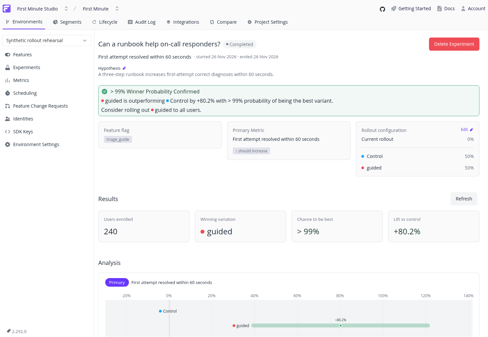

# First Minute

A 60-second incident drill that tests whether a short runbook helps people diagnose a checkout outage. Participants inspect a release log, service metrics and request traces, choose one diagnosis, and see where the slow request spent its time.


[Watch the 44-second captioned walkthrough](media/walkthrough.mp4)

## Play

For a no-install practice round, [download the drill](https://raw.githubusercontent.com/arpitkjaiswal/flagsmith1/main/examples/first-minute/media/first-minute.zip), unzip it and open `first-minute.html`. In the debrief, change the pool size halfway through a simulated incident and see when 600 waiting checkouts clear. Download the incident handoff to take away your diagnosis, the observed timings and your selected recovery plan. **How this round was counted** shows the desk and the SDK event receipts for a participant, or why a practice round was excluded.

To run from source, run `npm ci` and `npm run dev` with Node 24. Open the address Vite prints. Without a client-side environment key, the drill runs in practice mode. To make a portable, offline copy, run `npm run build:practice` and open `dist/first-minute.html`. Finish a round and choose **Try the other desk** to compare the layouts.

The published practice file is reproducible. Its SHA-256 is `012c27b4ec257629302a421bc7a51a4f084ee2d2a4d15918aedaa5f40c0d6c3c`. To reproduce `media/first-minute.zip`, run `npm run package:practice` with Node 24 and Python 3 installed. When publishing a new archive, update both README links to its commit and record its checksum here.

## Run the experiment locally

1. From the repository root, run `docker compose up -d`. Open `http://localhost:8000`, sign in and create an organisation if this is a fresh install. The supplied Compose file enables Experimentation and stores SDK events in PostgreSQL.
2. From `examples/first-minute`, run `python3 setup_experiment.py` in a terminal. Sign in with your local Flagsmith email and password. If your account belongs to several organisations, the script lists their names and IDs so you can rerun it with the chosen ID. It creates or reuses the First Minute project, Participant drill environment, warehouse connection, flag, metric and experiment. Copy the two printed `VITE_` lines into `.env.local`. For unattended setup, provide your local user token in `FLAGSMITH_MANAGEMENT_TOKEN` and run `python3 setup_experiment.py ORGANISATION_ID`.
3. Start or restart Vite. Its local SDK proxy forwards flags, identities and events to Flagsmith on port 8000. The briefing should say **Connected to Flagsmith**. Start the drill to enrol. For a shared deployment, set `VITE_FLAGSMITH_ORIGIN` to the HTTPS origin serving the Flagsmith API and SDK events. Set `VITE_FLAGSMITH_DASHBOARD_URL` to the address where your team signs in to view that experiment. Run `npm run build` and serve `dist` over HTTPS.
4. Open **Experiments** in the Participant drill environment and refresh the results after events arrive. The guide is a keyed variation of the `triage_guide` multivariate flag. All eligible identities enter the experiment, with equal allocation between control and guided.

If the self-hosted dashboard shows **Maintenance** because its bootstrap request is blocked, configure `FLAGSMITH_ON_FLAGSMITH_API_URL` and `FLAGSMITH_ON_FLAGSMITH_API_KEY` on the web service to read from a local dashboard configuration environment, then restart the service. [Self-hosting guide](../../docs/docs/deployment-self-hosting/core-configuration/running-flagsmith-on-flagsmith.md)

## What the experiment measures

**Hypothesis.** A three-step runbook increases the fraction of first-time participants who correctly diagnose connection-pool exhaustion within 60 seconds. Both variants use identical evidence, answer choices, time limit and feedback.

**Measurement.** Opening the first desk fixes eligibility for this browser. If a player starts in offline practice, later rounds on the same site stay in practice. Reading the briefing keeps the player eligible. An enrolled player gets 60 seconds from the moment the browser claims the desk. Reloading or opening another tab preserves the original assignment and deadline. A new browser profile or a separately downloaded file has its own storage.

The browser saves the first answer before showing the solution. If the participant site cannot read or save the first desk, it keeps the briefing open and offers a retry. The standalone download remains playable with browser storage disabled.

The participant site retries interrupted exposures and correct first-answer events with the original identity, variation and timestamps. When Flagsmith accepts an event, its receipt ends the retry. Flagsmith rejects events older than ten days. If its receipt reports that the delivery window has closed, the drill keeps the local result and tells the player. The warehouse counts exposed identities and whether each one resolved the drill. Replaying the same event after a lost acknowledgement preserves those counts.

**Evidence.** A separate automated run against local Flagsmith recorded three exposures and two conversions in the QA environment. The checked-in Playwright suite intercepts SDK requests to test browser behaviour. The in-app **Experiment replay** shows two separate 240-identity synthetic experiments measured by the SDK and local Flagsmith warehouse. Participants can open the replay after their first verdict. Opening the replay on the practice site records a practice visit for that origin. [QA snapshot](verification.json) · [Rehearsal results](rehearsal.json)

**Rollout.** Collect independent participant attempts and inspect sample-ratio warnings. Flagsmith shows “Collecting data” below its inference thresholds. Once sufficient evidence supports a decision, end the participant experiment and use the same flag to roll out the selected desk. If the evidence stays inconclusive, continue collecting data.

## Two experiment decisions

Select **Experiment replay** to compare two synthetic runs from 26 November 2026. In each run 240 stable identities received a desk from the real SDK. Both used the same 60-second resolution metric. The generator sets the probability of a correct diagnosis. Flagsmith computes the observed results.

| Synthetic input | Standard desk | Guided desk | 95% interval for guided relative lift | What happened |
| --- | ---: | ---: | ---: | --- |
| Standard 45%, guided 72% | 53/127 (41.7%) | 85/113 (75.2%) | +38.4% to +122.1% | Shipped guided in the rehearsal. All 16 fresh SDK identities received it. |
| Both desks 55% | 68/116 (58.6%) | 70/124 (56.5%) | −24.7% to +17.3% | Neither desk met the decision threshold. Flagsmith still served a 50/50 experiment. |

The percentage-point gap in the first run was +33.5 points. Relative lift divides that difference by the standard desk's resolution rate. The equal-chance run shows how ordinary sample variation can put one desk ahead even when the two input probabilities are identical. These runs exercise the measurement and rollout path. The effect on people is an open question. [Programmed-advantage data](rehearsal.json) · [Equal-chance data](equal-chance.json)



The original dashboard capture recommended control at 63% in the equal-chance run. First Minute kept the split. The fork’s dashboard fix applies the documented 95% probability threshold and suppresses the recommendation during a sample-ratio mismatch. [Original dashboard capture](media/equal-chance-results.png) · [Focused dashboard change](https://github.com/arpitkjaiswal/flagsmith1/commit/08edb17e2c53c0bf24647cd8cf688002efd21ac2)

### Reproduce the evidence

From this directory, run the two local rehearsals. They accept the same sign-in and optional organisation ID as the participant setup. The local API defaults to port 8000. Set `FLAGSMITH_LOCAL_PORT` for the Python commands and Vite if you use another loopback port.

```sh
python3 rehearse.py
python3 equal_chance.py
```

Each command provisions its own environment and outputs aggregate JSON. Stable identifiers make retries count towards the same sample. Each command waits for the warehouse counts to match the SDK and respects the five-minute refresh limit. When Flagsmith omits an allocation p-value, the rehearsals apply a two-sided exact binomial check against 50/50.

The rollout rule requires at least 50 identities and five successes per desk, a split-check p-value of at least 0.001, at least 95% chance for a desk to beat the other and a 95% relative-lift interval entirely on the winning side of zero. Only the programmed-advantage rehearsal may promote a desk. The equal-chance check reads the split back from Flagsmith and records any apparent winner as a diagnostic. The replay includes each original dashboard capture and a download of the corresponding warehouse summary.

### Report a participant run

In the **Participant drill** environment, refresh the results in the Flagsmith dashboard. Then export a shareable Markdown report using the same local credentials.

```sh
python3 participant_report.py > participant-results.md
```

This command reads the participant experiment's own metric, timestamp, per-desk counts, success rates and native inference. It reports missing data and failed refreshes explicitly. It makes no rollout changes.

## Browser checks

Run `npx playwright install chromium` once, then `npm test`. To use an existing Chromium installation, set `CHROMIUM_EXECUTABLE` to its path. The browser tests intercept SDK traffic locally and cover simultaneous submissions, interrupted connections, keyboard navigation, timeouts and practice exclusions. The rehearsal command above exercises the real API and warehouse.

With pytest installed, run `python3 -m pytest tests` for the experiment setup, rehearsal and participant-report checks.

## Submission copy

When checkout slows down, a responder often has a dashboard full of signals and has to work out what changed. First Minute lets anyone take the on-call seat. Players have 60 seconds to trace a slowdown through a release, service metrics and a slow request. Flagsmith assigns a plain desk or a three-step runbook and measures whether the player finds the root cause on their first attempt. The result helps the team decide whether every new responder should get the guide.
